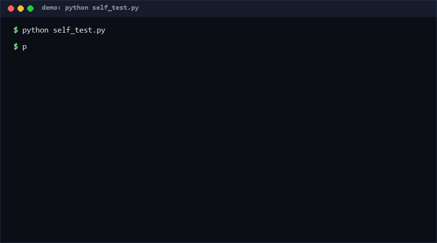

# cad-mcp-cleanroom

A cleanroom acceptance harness for CAD-style MCP command surfaces: it proves that a server's commands are deterministic, honestly declared read-only, and idempotent under replay — then emits a machine-readable PASS / REJECT report. If an agent will drive your CAD server unattended, run this audit before you let it run anything.

**Confidence: High (85%)** that replay-based purity/idempotence probing catches the mutation bugs agent loops actually hit; **Medium (65%)** that the bundled demo server resembles your real server's failure modes [estimated].

<p align="center"></p>

## Problem

Agent-driven CAD is spreading via MCP servers, but nobody verifies the *behavioral contract* of the command surface. Two failure classes dominate: a "read-only" query that silently mutates state (an agent replays it and corrupts the drawing), and a mutating command that is not idempotent (an agent retries after a timeout and the part is doubled). Unit tests check features; nothing checks the contract. That is the unguarded half of the MCP pipeline.

- **Why novel:** the family idea is "clean-room acceptance" — don't test whether commands do their job, test whether their *side-effect declarations are true*.
- **Overlooked angle:** idempotence is mechanically checkable: apply once, hash state, apply again, hash again. If the hashes differ, the command will corrupt any retrying agent's session.

## How it works

The audited server implements a tiny protocol: `execute(name, args) -> {ok, data, error}` and `state_hash()`. Commands in a JSON manifest declare `purity: read-only | mutating`. The harness then runs:

| Check | Method | Verdict trigger |
|---|---|---|
| determinism | run read-only command N times, compare SHA-256 of canonical output | hashes differ |
| purity | hash state before/after a read-only command | state changed |
| idempotence | apply mutating command, hash, re-apply, hash | hashes differ |
| schema | output keys vs declared JSON-ish types | missing/mistyped key |
| session_drift | replay the manifest through two fresh sessions, compare outputs and final state step-by-step | any pairwise divergence |
| surface_exposure | score the manifest: mutating share (−40 max), avg declared args (−20 max), escape hatches (−25 each); undeclared purity counts as mutating | informational score/grade A–D |
| unknown command | name not in protocol | reported as ERROR |

Canonicalization is stable JSON (sorted keys, no whitespace), so results are byte-reproducible across runs. The bundled `FakeCadServer` is a deliberately imperfect reference: `append_point_seq` appends on every call and *should* be rejected — the demo shows a real REJECT, not a staged success.

## How this differs from daobataotie/CAD-MCP

daobataotie/CAD-MCP (590★ as of 2026-10-11) is an MCP server that drives real CAD applications — AutoCAD, GstarCAD, ZWCAD — over Windows COM. Credit where due: it actually draws. Its README lists 35 tools (drawing, editing, layers, blocks, query, screenshot preview), a command-passthrough escape hatch (`send_command`), structured output, tool annotations, and dual stdio/streamable-http transport. It ships a working product for people who have CAD installed on Windows.

This repo deliberately does none of that. It is an acceptance harness for command surfaces like CAD-MCP's — it cannot draw a single line, and it does not wrap any CAD application. Two capabilities its README does not offer (its Features and MCP Protocol Features lists cover functional and wire-protocol scope only; no behavioral verification, no cross-session consistency check, no exposure quantification):

- **Cross-session drift detection** — CAD-MCP supports multiple clients sharing one CAD instance over streamable-http, but its README describes no way to verify that two sessions of a server behave identically. This harness replays the same manifest through two fresh sessions and flags any pairwise output or final-state divergence (module-level globals, wall-clock leakage, shared counters).
- **Command-surface exposure scoring** — CAD-MCP exposes `send_command` as "an escape hatch for everything else"; the README quantifies nothing about surface risk. `surface_score` turns a manifest into a 0–100 exposure grade (mutating ratio, argument complexity, escape hatches penalized) so you can compare servers before letting an agent loose on them.

The two are complements, not competitors: use CAD-MCP to draw, and this harness to prove its command surface is safe for unattended replay.

## Quickstart (~2 min)

```bash
# 1. Self-test: 22 checks across functional / error-path / extreme-edge (~2 s)
python self_test.py

# 2. Demo audit against the reference server, incl. cross-session drift (~1 s)
python cli.py audit --demo --drift
#   -> REJECT (append_point_seq fails idempotence); exit code 1

# 3. Score a manifest's command-surface exposure (no server needed)
python cli.py exposure --demo    # -> 75/B moderate

# 4. Audit your own server: implement the protocol, write a manifest
python cli.py audit my_manifest.json --drift --report report.json
```

Exit codes: 0 = PASS, 1 = REJECT, 2 = ERROR (CI-gate friendly).

## Why not X

| Alternative | Why not |
|---|---|
| MCP protocol conformance suites | Check wire-format compliance, not behavioral side-effect honesty; a perfectly conformant server can still be non-idempotent |
| Unit tests per command | Written by the same author with the same blind spots; the harness asks the adversarial question ("is your purity declaration a lie?") that feature tests never ask |
| Property-based testing (Hypothesis-style) | Great for values, heavyweight for state contracts; requires infrastructure, while this is a zero-dependency CI step with a fixed, explainable rule set |
| Manual staging review | Human reviewers cannot mentally replay 200 commands × retries; machines can |

## Minimal Fallback (PLAN B)

No Python on the target box? The contract is three documented sentences above (determinism, purity, idempotence) plus the manifest schema in this README. You can enforce it with two `curl` calls and `diff` on your server's JSON responses, or run this harness anywhere Python 3.8+ exists — it imports nothing outside the standard library.

## Design Trade-offs

Priority order: **safety > simplicity > coverage**. We hash server state rather than diffing full snapshots (cheap, but a collision could mask a mutation — SHA-256 collisions are not a realistic threat here). Idempotence testing resets state via a `cleanroom_reset` command, which means audited servers must expose one (small integration cost, big determinism win). We do not fuzz argument values: this is a contract checker, not a fuzzer — wrong-value behavior is the unit tests' job.

## Limits & Second-order Effects

- `state_hash()` must actually cover all persistent state; if your server keeps secrets from its own hash, purity checking is theater.
- Wide adoption could make teams declare everything `mutating` to dodge purity probes — the honest fix is state accessors, not declaration gaming.
- A PASS here does not mean commands are *correct* (a deterministically wrong arc is still wrong); it means the contract is safe for unattended replay.
- If agents learn "only call audited servers," unaudited side channels (file writes) become the new blind spot.

## FAQ

**Does this test my geometry kernel?** No. It tests the *contract*: determinism, purity, idempotence, schema shape. Correctness of the geometry is your unit tests' job.

**Why a reset command?** Idempotence probing needs a known starting point. `cleanroom_reset` makes the probe order-independent and the audit replayable — the harness holds itself to the same standards it checks.

**When NOT to use this?** Don't use it if your server is stateless per-call (every request self-contained: nothing to mutate means nothing to probe — a plain determinism check suffices), or while interactively designing commands (the contract only matters once an agent will replay them unattended). Don't use it as your only test layer either; it verifies safety properties, not business logic.

**Can it audit a remote server over the wire?** Not in v0.1 — you wrap your server in the in-process protocol adapter (~20 lines). A wire-level adapter is the natural next step.

## [Core Assumptions]

1. The server can expose `state_hash()` covering *all* persistent state — without it, purity probing is impossible.
2. Mutating commands can be made idempotent via upsert-style keys (entity IDs), which is the standard fix pattern in CAD-like domains.
3. SHA-256 over canonical JSON is a sufficient state fingerprint for this threat model (accidental mutation, not adversarial collision).
4. Command manifests are maintained as code, next to the server, so declarations don't drift from behavior.

*Data as of 2026-10-11. Measured numbers: see `python self_test.py` (22 checks, ~2 s on Windows 10 / CPython 3.11). Anchor facts (CAD-MCP tool count, stars) from its README as of this date. Other timings [estimated].*
